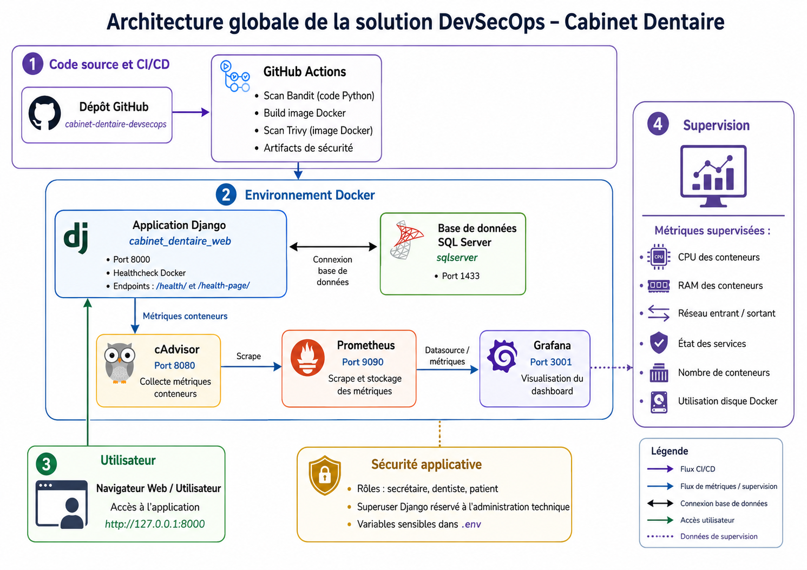
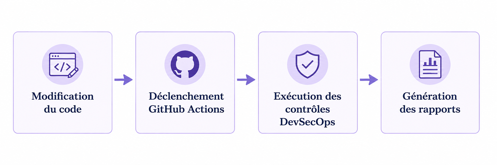
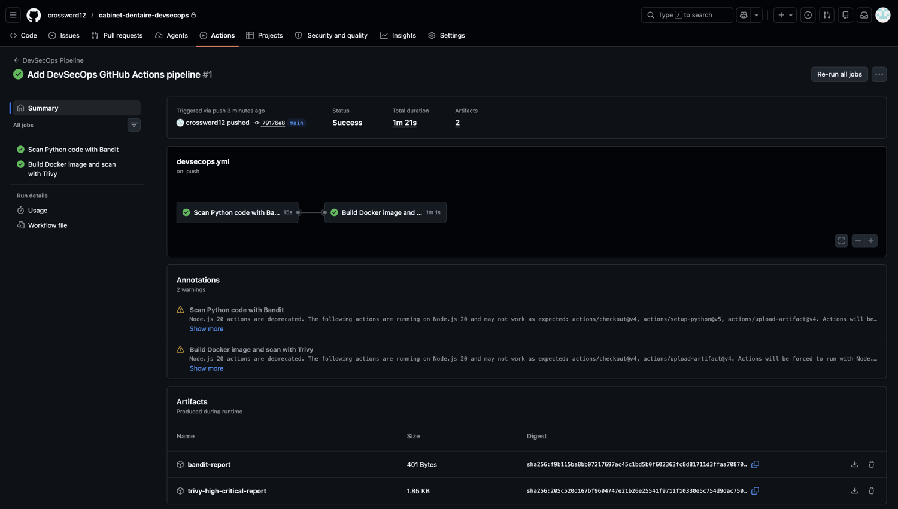
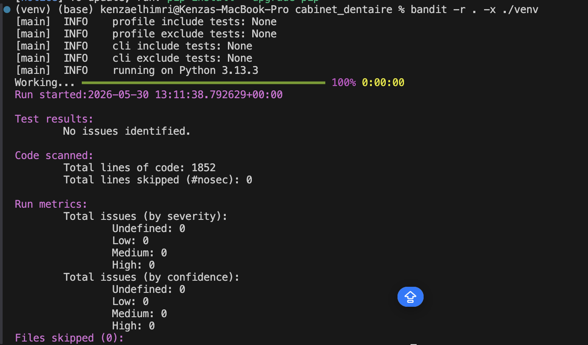
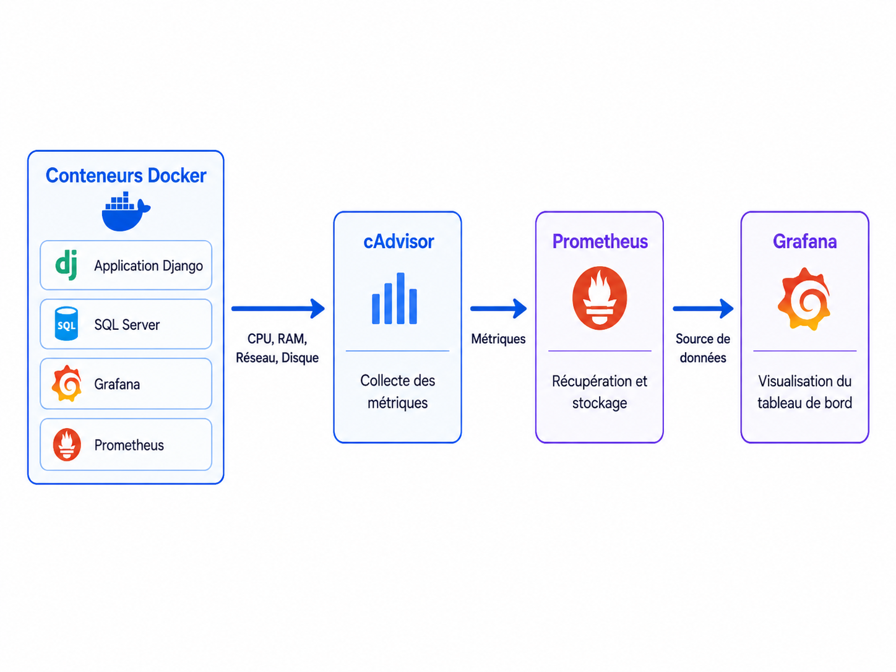
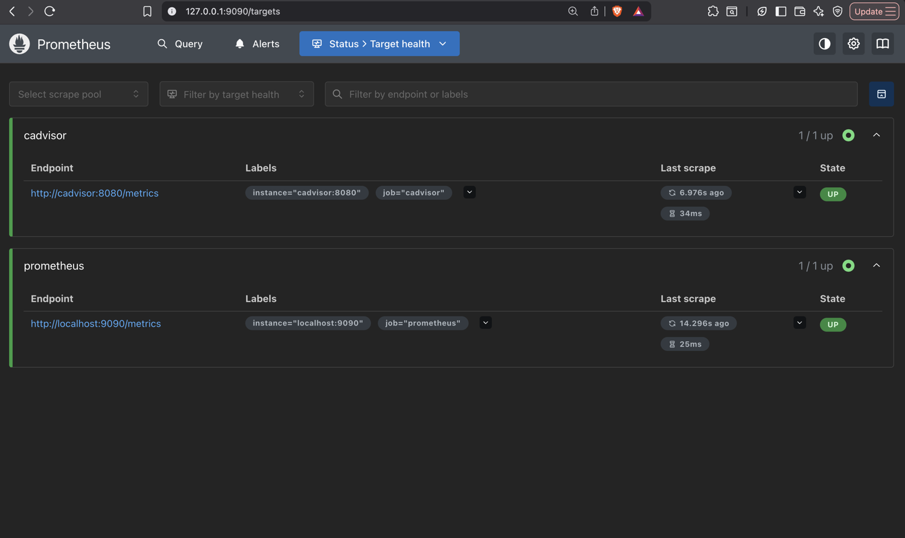
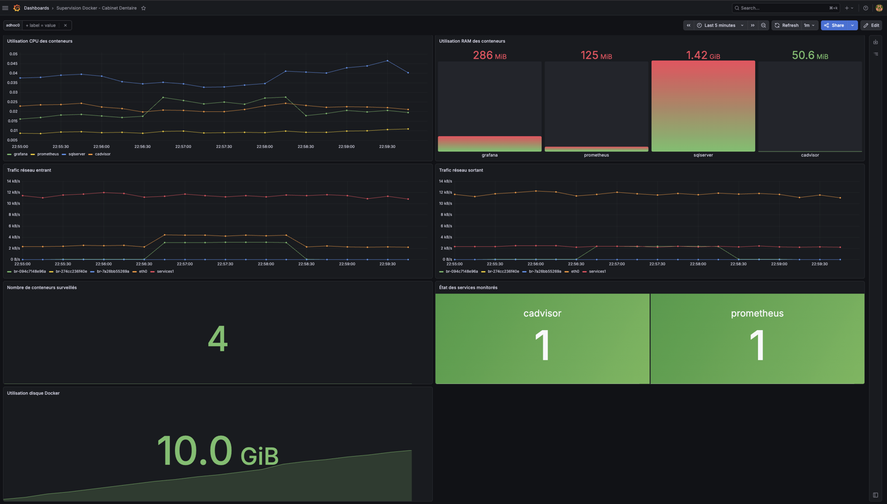

# 🦷 Cabinet Dentaire — DevSecOps

**Sécurisation de la chaîne de conteneurisation d'une application Django de gestion de cabinet dentaire.**

    

> **Projet académique — démonstration locale.** L'environnement fourni n'est pas une configuration prête pour la production et ne doit pas contenir de données réelles de patients.

## Sommaire

1. [Présentation](#1-présentation)
2. [Objectifs](#2-objectifs)
3. [Fonctionnalités et rôles](#3-fonctionnalités-et-rôles)
4. [Stack technique](#4-stack-technique)
5. [Architecture DevSecOps](#5-architecture-devsecops)
6. [Installation locale](#6-installation-locale)
7. [Pipeline CI et contrôles de sécurité](#7-pipeline-ci-et-contrôles-de-sécurité)
8. [Contrôle d'accès applicatif](#8-contrôle-daccès-applicatif)
9. [Supervision](#9-supervision)
10. [Sécurité et risques résiduels](#10-sécurité-et-risques-résiduels)
11. [Structure du dépôt](#11-structure-du-dépôt)
12. [Bilan](#12-bilan)

## 1. Présentation

Ce projet de fin d'année met en œuvre une **approche DevSecOps** pour une application web développée avec **Django** et connectée à **Microsoft SQL Server**. L'application permet de gérer les patients, les rendez-vous, les soins et les profils utilisateurs d'un cabinet dentaire.

L'objectif principal est de sécuriser le parcours du code source jusqu'à l'environnement d'exécution : **configuration, image Docker, analyses automatisées, contrôle d'accès et observabilité**.

## 2. Objectifs

- Conteneuriser une application Django avec Docker et Docker Compose.
- Externaliser les secrets et les paramètres de connexion.
- Analyser le code Python avec **Bandit**.
- Détecter les vulnérabilités de l'image avec **Trivy**.
- Automatiser ces vérifications avec **GitHub Actions**.
- Tester la séparation des droits entre les rôles applicatifs.
- Superviser les conteneurs avec **cAdvisor, Prometheus et Grafana**.
- Documenter les limites et les risques résiduels.

## 3. Fonctionnalités et rôles

| Profil | Accès principal |
| --- | --- |
| **Secrétaire** | Gestion des patients, rendez-vous et soins |
| **Dentiste** | Consultation des patients et rendez-vous |
| **Patient** | Consultation de ses propres rendez-vous et du catalogue des soins |
| **Superutilisateur Django** | Administration technique des comptes, groupes et permissions |

Le contrôle d'accès est appliqué côté application, et non seulement dans l'interface utilisateur.

## 4. Stack technique

| Domaine | Technologies |
| --- | --- |
| Application | Python, Django, HTML/CSS |
| Base de données | Microsoft SQL Server, pilote ODBC |
| Conteneurisation | Docker, Docker Compose |
| Sécurité | Bandit, Trivy, paramètres de sécurité Django |
| Automatisation | GitHub Actions, Dependabot |
| Supervision | cAdvisor, Prometheus, Grafana |
| Versionnement | Git, GitHub |

## 5. Architecture DevSecOps



*Architecture globale : code source, pipeline, application conteneurisée, contrôles de sécurité et supervision.*

La solution combine une application Django, une connexion SQL Server et des services de supervision. Les analyses de sécurité sont automatisées dans GitHub Actions.

## 6. Installation locale

### Prérequis

- Docker et Docker Compose installés.
- Une instance **SQL Server accessible** depuis l'environnement Docker : la base n'est **pas incluse** parmi les services du fichier `docker-compose.yml`.
- Une base SQL Server et des identifiants de développement valides.

### Préparer la configuration

Cloner le dépôt :

```bash
git clone https://github.com/crossword12/cabinet-dentaire-devsecops.git
cd cabinet-dentaire-devsecops
```

Créer le fichier local `.env` à partir de l'exemple :

```bash
cp .env.example .env
```

Renseigner les variables dans `.env` avec **des valeurs locales**, notamment :

```dotenv
SECRET_KEY=replace-with-a-generated-django-secret-key
DEBUG=False
ALLOWED_HOSTS=localhost,127.0.0.1,web

DB_NAME=your_database_name
DB_USER=your_database_user
DB_PASSWORD=your_local_database_password
DB_HOST=host.docker.internal
DB_PORT=1433

GRAFANA_ADMIN_PASSWORD=choose-a-strong-local-password

# Paramètres réservés à une démonstration HTTP locale
SECURE_SSL_REDIRECT=False
SESSION_COOKIE_SECURE=False
CSRF_COOKIE_SECURE=False
SECURE_HSTS_SECONDS=0
SECURE_HSTS_INCLUDE_SUBDOMAINS=False
SECURE_HSTS_PRELOAD=False
```

> Ne jamais envoyer `.env` sur GitHub. Les valeurs ci-dessus sont des **exemples**, pas des identifiants utilisables. Docker Compose lit `GRAFANA_ADMIN_PASSWORD` depuis l'environnement ou le `.env` du répertoire du projet.

### Démarrer les services

```bash
docker compose up --build -d
```

Afficher leur état et consulter les journaux :

```bash
docker compose ps
docker compose logs -f web
```

Si la base est prête et que l'application est correctement configurée, l'interface est accessible sur **http://localhost:8000**.

Arrêter les services :

```bash
docker compose down
```

> **Important :** l'environnement local repose sur une instance SQL Server externe. Selon la machine, l'hôte `host.docker.internal` devra être adapté. L'installation des tables et les comptes de démonstration dépendent de la préparation de cette base. Le démarrage seul ne garantit pas une application opérationnelle.

## 7. Pipeline CI et contrôles de sécurité

### Fonctionnement



La pipeline GitHub Actions récupère le code, exécute les vérifications et génère des rapports téléchargeables.



### Analyse statique avec Bandit

Bandit détecte des pratiques potentiellement risquées dans le code Python. Exemple de commande locale :

```bash
bandit -r . -x ./venv,./.venv
```



*Capture d'un scan Bandit effectué pendant le projet ; le résultat dépend de la version du code analysée.*

### Scan de l'image avec Trivy

Après construction de l'image, Trivy recherche les vulnérabilités connues :

```bash
trivy image cabinet-dentaire:1.8
trivy image --severity HIGH,CRITICAL cabinet-dentaire:1.8
```

Les rapports de pipeline sont publiés sous forme d'artifacts, dont `bandit-report` et `trivy-high-critical-report`.

**État de dépendances vérifié sur GitHub le 28 octobre 2026 :** 0 alerte Dependabot ouverte après les mises à jour de Django et de `sqlparse`. Ce résultat ne garantit pas l'absence de vulnérabilités dans le code ou les images système.

## 8. Contrôle d'accès applicatif

Des scénarios manuels ont été exécutés pour valider les droits d'accès :

| Route / action | Profil | Résultat observé |
| --- | --- | --- |
| `/admin/` | Superutilisateur | Autorisé |
| `/admin/` | Secrétaire | Refusé |
| `/patients/` | Secrétaire | Autorisé |
| `/patients/` | Patient | Refusé ou redirigé |
| `/soins/catalogue/` | Visiteur | Consultation autorisée |
| `/soins/catalogue/` | Patient | Consultation sans actions sensibles |
| `/soins/catalogue/` | Secrétaire | Actions de gestion autorisées |
| `/rendezvous/mes/` | Patient | Autorisé |
| `/rendezvous/tous/` | Patient | Refusé ou redirigé |
| `/rendezvous/tous/` | Secrétaire | Autorisé |

Ces résultats correspondent aux scénarios de test documentés pendant le projet et ne remplacent pas une campagne complète de tests d'intrusion.

## 9. Supervision

La solution utilise **cAdvisor** pour collecter les métriques, **Prometheus** pour les récupérer et les stocker, et **Grafana** pour les visualiser.



### Accès aux services locaux

| Service | URL |
| --- | --- |
| Application Django | http://localhost:8000 |
| cAdvisor | http://localhost:8080 |
| Prometheus | http://localhost:9090 |
| Grafana | http://localhost:3001 |



*Contrôle des cibles collectées par Prometheus pendant les tests.*



*Tableau de bord Grafana : état des services, CPU, mémoire, réseau et ressources Docker.*

> Dans cette configuration de **laboratoire**, les interfaces de supervision sont exposées sur les ports locaux indiqués. Pour un déploiement réel, restreindre leur exposition réseau et renforcer l'authentification des services.

## 10. Sécurité et risques résiduels

Mesures présentes dans le projet :

- `SECRET_KEY` et identifiants SQL Server fournis par variables d'environnement.
- `DEBUG=False` par défaut dans la configuration actuelle.
- Cookies HTTPOnly, protections CSRF, `X_FRAME_OPTIONS="DENY"` et `SECURE_CONTENT_TYPE_NOSNIFF`.
- Options de sécurité HTTPS configurables pour un environnement de production.
- Exécution de scans Bandit et Trivy et suivi des dépendances par Dependabot.

**Limites connues de la démonstration :**

- Les options HTTPS ne sont pas activées par défaut pour les essais sur `localhost`.
- Le paramètre SQL Server `TrustServerCertificate=yes` ne vérifie pas la chaîne de confiance du certificat serveur.
- Le service cAdvisor utilise un mode privilégié et des montages de l'hôte : à réserver à un environnement contrôlé.
- Certaines vulnérabilités de packages système peuvent subsister dans l'image Docker ; consulter les rapports Trivy récents avant tout déploiement.
- Les exemples de mots de passe sont réservés au laboratoire et ne doivent pas servir à protéger des services exposés.

**Ce dépôt est destiné à l'apprentissage et à la démonstration DevSecOps ; il n'est pas fourni comme solution prête à héberger de véritables dossiers médicaux.**

## 11. Structure du dépôt

```text
cabinet-dentaire-devsecops/
├── .github/workflows/      # Pipeline CI / analyses de sécurité
├── cabinet_dentaire/       # Configuration Django
├── comptes/                # Comptes, rôles et profils
├── patients/               # Gestion des patients
├── rendezvous/             # Gestion des rendez-vous
├── soins/                  # Catalogue des soins
├── monitoring/             # Configuration Prometheus / dashboard Grafana
├── static/                 # Ressources statiques
├── templates/              # Templates Django
├── images/                 # Captures illustrant le projet pour ce README
├── Dockerfile
├── docker-compose.yml
├── requirements.txt
├── requirements-dev.txt
├── .env.example
└── README.md
```

## 12. Bilan

Ce projet illustre l'intégration de la sécurité dans une application Django conteneurisée : **analyse du code, contrôle des dépendances, scan d'image, automatisation, gestion des accès et supervision**.

Il constitue une démonstration pratique de la démarche DevSecOps dans un contexte de gestion de cabinet dentaire, avec une attention particulière à la documentation des risques résiduels.

---

*Projet de fin d'année — année universitaire 2025–2026.*
